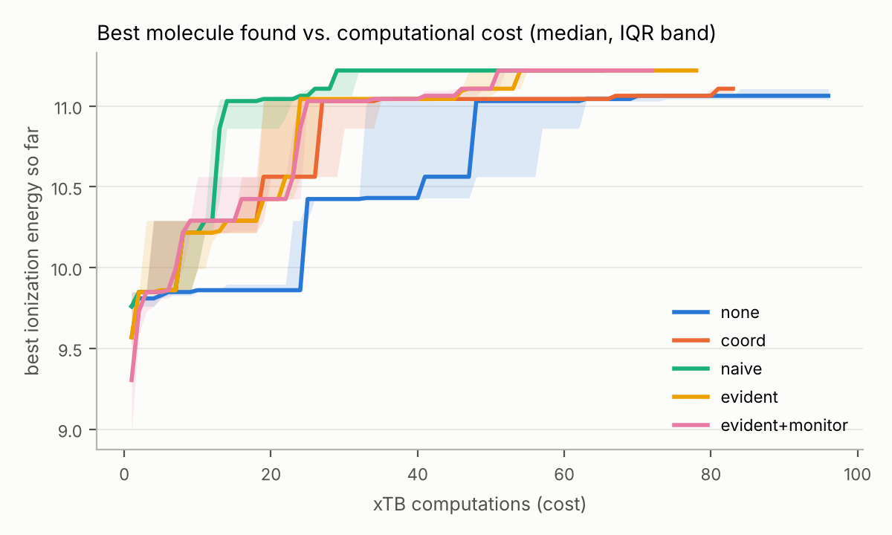
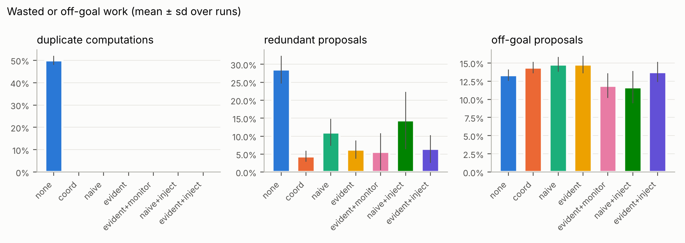
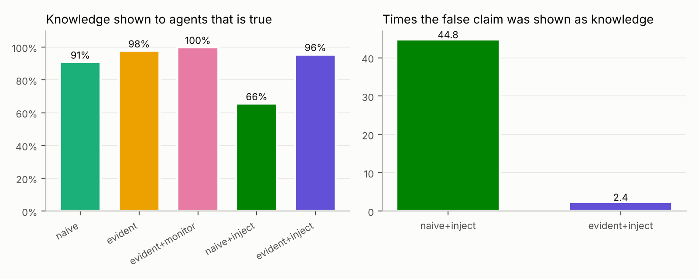

# EVIDENT — une mémoire partagée fondée sur les preuves pour des équipes d'agents scientifiques

*Document de méthode — PFE « Persistent and Stateful AI Agents for Long-Running Scientific
Workflows », papier atelier ACX 2027. Code : paquet `evident/`, expériences : `experiments/`.*

---

## 0. Résumé

Des agents LLM qui cherchent ensemble des molécules à forte énergie d'ionisation (GAIED : Academy
+ LangGraph + xTB, provenance Flowcept) partagent aujourd'hui, dans la plupart des systèmes de
mémoire, **du texte écrit par le LLM** : des « leçons » que personne ne vérifie. Une leçon fausse
(hallucinée, tirée de trois points, ou injectée) est alors relue par toute l'équipe et oriente
ses choix. EVIDENT renverse la règle : **seul ce qui est mesuré entre dans la mémoire comme un
fait, et une affirmation d'un agent n'est montrée aux autres qu'après avoir été vérifiée par le
code contre l'ensemble des faits mesurés par l'équipe, avec ses chiffres**. La même structure
sert au contrôle en temps réel : chaque décision d'un agent est publiée *avant* d'être exécutée,
un agent d'analyse peut l'arrêter au milieu d'une activité et l'agent replanifie.

Contributions proposées pour l'atelier :

1. **Une mémoire à règles d'écriture distinctes** (faits / coordination / affirmations /
   directives / télémétrie) : le LLM ne peut écrire ni un fait ni le statut d'une affirmation.
2. **Une vérification automatique des affirmations** dans un vocabulaire fermé, par effet
   ajusté (régression) et réplication entre agents, avec un cycle de vie versionné
   (proposée → soutenue → établie → contestée / rejetée), sans suppression.
3. **Un contrôle en temps réel** : décisions publiées avant exécution, directive STOP qui annule
   l'activité en cours (calcul ou appel au LLM) en quelques millisecondes, puis replanification.
4. **Un protocole d'évaluation par ablation** (7 conditions) qui sépare l'effet de la
   coordination, de la connaissance partagée vérifiée ou non, de la robustesse à une
   affirmation fausse injectée, et du contrôle temps réel ; avec un banc synthétique à vérité
   connue pour valider chaque mécanisme.

Cela répond directement à la question d'Amal : *comment les données (mémoire et provenance)
améliorent-elles la qualité d'un système agentique scientifique ?* — en rendant mesurables et
évitables le travail redondant, les croyances fausses, et les déviations par rapport au but.

---

## 1. Point de départ : ce que faisait la première version

La première mémoire (`shared_memory.py`, supprimée dans cette branche) partageait les résultats
xTB, évitait les doublons par verrou Redis, et diffusait les conclusions des agents comme
« leçons » textuelles. Les campagnes réelles ont montré trois problèmes :

- des **leçons fausses** : molécule mal nommée (« N-fluoro-N-methylurea » pour
  `FC(F)(F)C(=O)Nc1ccccc1`), affirmation causale (« stabilise ») non fondée ; elles étaient
  pourtant montrées aux autres agents comme de la connaissance ;
- **aucun moyen de juger une leçon** : texte libre, coupé à 300 caractères, sans chiffres ;
- **aucune mesure** permettant de dire si la mémoire améliore ou dégrade la campagne.

C'est le diagnostic de Trehan et Chopra (Lossfunk, « Why LLMs Aren't Scientists Yet », 2026) :
sur-enthousiasme (déclarer un succès malgré des échecs clairs), dégradation de la mémoire et du
contexte sur les tâches longues, dérive d'implémentation, goût scientifique faible ; et parmi
leurs principes : **tout vérifier à chaque étape** et **tout journaliser**.

---

## 2. Limites des systèmes existants

| Système | Ce qu'il fait bien | Limite pour notre cas |
|---|---|---|
| **Mem0** (Chhikara et al., 2025) | extraction de faits par LLM, opérations ADD/UPDATE/DELETE, recherche vectorielle | c'est le **LLM qui décide** d'ajouter, modifier ou effacer ; une mise à jour **écrase** ; pas de lien vers la mesure |
| **Letta / MemGPT** (Packer et al., 2023) | mémoire hiérarchique type OS, l'agent édite sa mémoire par appels de fonctions | mémoire **d'un agent**, éditée par lui-même, sans contrôle de vérité |
| **Zep / Graphiti** (Rasmussen et al., 2025) | graphe de connaissances **bi-temporel** : un fait contredit est invalidé, pas supprimé | la contradiction est décidée par le LLM à partir du texte, pas par des mesures |
| **A-MEM** (Xu et al., 2025) | notes reliées (Zettelkasten), « évolution » des notes existantes | le LLM **réécrit** les anciennes notes : la trace de ce qui était cru disparaît |
| **Generative Agents** (Park et al., 2023), **Reflexion** (Shinn et al., 2023) | réflexions et leçons verbales stockées et relues | leçons non vérifiées ; une réflexion fausse se renforce |
| **FALDA** (Stevens et al., Argonne) | niveaux T0–T3 (flux, atomes, scènes, cœur), SQLite + recherche vectorielle + BM25 (FTS5) + fusion RRF, pools partagés none/read/readwrite | les atomes n'ont **ni auteur, ni provenance, ni statut** ; *upsert* qui écrase, suppression définitive ; distillation par LLM **sans vérification** ; un seul écrivain |
| **NVIDIA auto-ontology** (2026) | Générer → **Certifier** → Répondre ; drapeaux `certified`, vérification « répondable », provenance de chaque réponse, outils MCP | la certification est **humaine** et porte sur un schéma de données d'entreprise, pas sur des hypothèses scientifiques |
| **Collaborative Memory** (Rezazadeh et al., 2025) | mémoire multi-utilisateurs, niveaux privé/partagé, contrôle d'accès dynamique, attributs de provenance | contrôle **qui** peut lire/écrire, pas **si c'est vrai** |
| Mémoires gérées (AWS AgentCore, Vertex Memory Bank, mémoires de Claude Managed Agents) | court/long terme, extraction asynchrone, versions, concurrence optimiste, avertissement sur l'injection de prompt | mémoire de conversation/utilisateur ; aucune notion de mesure ou de preuve |
| **Google AI co-scientist** (Gottweis et al., 2025) | multi-agents, tournoi Elo, « proximité » pour dédupliquer, mémoire de contexte pour reprendre | classement par **débat entre LLM** ; aucune vérification expérimentale dans la boucle |
| **AI Scientist v2** (Yamada et al., 2025) | recherche arborescente d'expériences | mémoire = l'arbre d'un seul système ; pas de partage vérifié entre agents |
| **OmniScientist** (2025) | registre de contributions **immuable** (ContributionLedger) | trace qui a contribué, pas la validité de la contribution |
| Attaques **AgentPoison** (Chen et al., 2024), **MINJA** (Dong et al., 2025), défenses (2026) | montrent qu'une mémoire d'agent peut être empoisonnée, même par simple interaction | les défenses filtrent ou notent la confiance du texte ; elles ne confrontent pas le contenu à des mesures |
| **Flowcept / PROV-AGENT** (Souza et al., 2025) | provenance unifiée des agents, des appels LLM et des tâches | la provenance est **observée après coup** ; rien ne la renvoie aux agents pendant la campagne |

On en tire six limites, que la conception d'EVIDENT reprend une par une :

- **L1 — Le LLM écrit la connaissance.** Ce qui est mémorisé est ce que le LLM *dit*, pas ce qui
  a été *mesuré*.
- **L2 — Pas d'ancrage dans les données brutes.** Une entrée de mémoire ne pointe pas vers la
  mesure (la tâche de provenance) qui la justifie.
- **L3 — Pas de coordination entre agents.** Mémoires mono-agent ou mono-écrivain : deux agents
  refont le même calcul.
- **L4 — Écrasement et suppression.** La mémoire ne garde pas l'histoire de ce qui était cru,
  donc on ne peut pas auditer une décision passée.
- **L5 — Vulnérabilité à l'empoisonnement.** Un agent qui se trompe (ou est compromis) contamine
  tous les autres.
- **L6 — Mémoire passive.** Elle sert à relire, pas à intervenir pendant que l'agent agit.

## 3. Principes de conception

| Principe | Mise en œuvre | Limite traitée |
|---|---|---|
| **P1. Les faits viennent de l'exécution, pas du LLM** | seul le code qui a lancé xTB écrit un fait, avec le `task_id` Flowcept de la tâche | L1, L2 |
| **P2. Une affirmation est une hypothèse testable** | vocabulaire fermé de caractéristiques chimiques (SMARTS) ; direction « augmente / diminue » | L1 |
| **P3. Le statut est calculé, jamais déclaré** | statistiques sur *tous* les faits de l'équipe ; réplication par au moins deux agents | L1, L5 |
| **P4. On ne supprime rien** | journal append-only des faits ; chaque changement de statut est une nouvelle version | L4 |
| **P5. Coordination explicite** | réservation par bail dès la proposition, échecs partagés, notification push des résultats, topics typés avec enveloppe commune | L3 |
| **P6. Les décisions sont publiées avant d'être exécutées** | télémétrie temps réel + directives + annulation | L6 |

## 4. Architecture

```
                          ┌──────────────────────── Redis : ev:{campagne}:… ────────────────────────┐
 agent A ─ plan ──────────► decision (télémétrie)                                                    │
        ─ tool_calling ──► proposals (télémétrie, AVANT le calcul) ─────► agent d'analyse (monitor) │
        ─ simulate ──────► lock:{smiles}  →  xTB  →  FAIT (facts, task_id Flowcept)                   │
        ─ conclude ──────► CLAIMS (vocabulaire fermé) ──► vérificateur (code) ──► statut versionné    │
        ◄─ briefing ─────  Goal + résultats + connaissance VÉRIFIÉE + avertissements + directives     │
        ◄─ STOP / conseil ─ directives:{agent}  ◄───────────────────────────── monitor / Nadjiba    │
                          └─────────────────────────────────────────────────────────────────────────┘
                     Flowcept (provenance) : mêmes task_id → audit complet de chaque fait
```

### 4.1 Les cinq types d'entrées (et qui a le droit d'écrire)

| Entrée | Clés Redis | Écrit par | Lu par | Règle |
|---|---|---|---|---|
| **Fait** | `facts` (flux, tous les calculs, doublons compris), `facts:by_smiles`, `ranking`, `failed` | le code de calcul uniquement | agents (briefing), vérificateur, analyse | append-only ; un fait = SMILES canonique, énergie ou erreur, agent, `task_id`, durée, caractéristiques |
| **Coordination** | `lock:{smiles}` (bail SET NX EX), `inprogress`, topic `reservations` | l'agent qui a proposé la molécule | les autres agents | réservation dès la proposition ; bail court renouvelé (agent planté : molécule libre après un bail) ; libération atomique (Lua) |
| **Affirmation** | `claims` (état courant), `claims:log` (versions) | l'agent *propose* ; le **vérificateur** fixe le statut | briefing (seulement si vérifiée), monitor | jamais supprimée ; chaque changement de statut = version |
| **Directive** | `directives:{agent}`, `directives:*` | agents d'analyse (monitor, Nadjiba) | l'agent ciblé, en temps réel | `stop` (annule) ou `advice` (affichée dans le briefing) |
| **Télémétrie** | `telemetry` (flux) | tout le monde | monitor (temps réel), analyse (après) | propositions, calculs, briefings montrés, directives, durées des nœuds |

S'y ajoutent `goal` (objectif + **contraintes vérifiables** : nombre maximal d'atomes lourds,
éléments autorisés) et `meta` (configuration de la campagne). Le mode `naive` utilise en plus
`lessons` (conclusions brutes), uniquement pour la comparaison.

### 4.2 Faits, coordination et notification (push)

**Le cycle d'une molécule**, inspiré des baux (*leases*) de Chubby et etcd, des *futures*
partagées de Ray et Dask, et des files de travaux :

1. **RÉSERVATION dès la décision** : quand `tool_calling` a choisi ses molécules,
   `record_proposals` réserve chaque molécule nouvelle par un **bail** (`SET NX EX`, atomique,
   30 s par défaut) et le publie sur le topic `reservations`. Toute l'équipe voit ce qui est
   pris **avant** le moindre calcul.
2. **LECTURE** au moment du calcul : le fait existe-t-il (SMILES canonique RDKit : `CCO` = `OCC`) ?
   → réutilisé, y compris un **échec** (une molécule invalide n'est essayée qu'une fois par l'équipe).
3. Si l'agent tient le bail (ou l'obtient) : **calcul** xTB, *surveillé* (annulable par STOP,
   §4.6) ; le bail est **renouvelé** toutes les 10 s tant que l'agent y travaille.
4. **ÉCRITURE** du fait avec le `task_id` de la tâche Flowcept, **publication** sur le topic
   `facts`, **libération** du bail. À la fin de `simulate`, les baux des molécules non calculées
   sont libérés.
5. Si un **autre** agent tient le bail : l'agent ne recalcule pas et **n'interroge pas** la
   mémoire en boucle. Il s'abonne au résultat et il est **réveillé dès sa publication** (push).
   Si le détenteur a planté, son bail n'est plus renouvelé et expire : l'agent reprend la
   molécule après au plus un bail (30 s, contre 15 min pour le verrou de la première version).

**Push ou pull.** Au sens des systèmes distribués (*push* : le système notifie les intéressés dès
qu'une information change ; *pull* : chacun la demande, éventuellement en redemandant
régulièrement), EVIDENT est maintenant **push** : chaque agent a un **écouteur** (`bus.py`,
un fil bloqué sur `XREAD BLOCK`) abonné au topic `facts` et à ses directives. Le mode pull est
conservé (`EVIDENT_NOTIFY=poll` : relecture toutes les 1 s pour les faits, 0,5 s pour les
directives) pour mesurer la différence (`experiments/bench_coordination.py`, Redis local) :

| Mesure (médiane / 95ᵉ centile) | push | poll |
|---|---|---|
| réservation visible par l'équipe | 0,8 / 1,1 ms | 1,1 / 1,2 ms |
| fait publié → agent en attente réveillé | **0,7 / 1,1 ms** | 445 / 933 ms |
| STOP envoyé → calcul annulé | **28 / 47 ms** | 261 / 492 ms |
| détenteur planté (bail de 2 s) → molécule reprise | 2,05 s | 2,01 s |

Le STOP en push n'est pas instantané : la directive arrive en ~1 ms, mais l'activité en cours
vérifie l'état local toutes les 50 ms. La reprise après plantage est fixée par la durée du bail,
pas par le mode de notification.

### 4.3 Topics et enveloppe commune

Un **topic par type de message**, dans des **Redis Streams** plutôt qu'en pub/sub : un stream
garde ses messages, un abonné occupé ou redémarré relit ce qu'il a manqué depuis son dernier
identifiant (le pub/sub les perd). Les analyses de Nadjiba peuvent s'abonner aux topics qui les
intéressent, en direct ou après coup.

| Topic (clé Redis) | Événements | Écrit par | Lu par |
|---|---|---|---|
| `topic:reservations` | `reserved`, `released` | l'agent qui réserve | agents, analyse |
| `topic:facts` | `fact` (énergie ou échec) | le code qui a calculé | **écouteur de chaque agent** (réveil), analyse |
| `topic:claims` | `status` (changement de statut, version, preuves) | le vérificateur | analyse |
| `topic:decisions` | `plan`, `proposals` (avant exécution) | les agents | analyse, moniteur |
| `directives:{agent}`, `directives:*` | `stop`, `advice` | agents d'analyse | **écouteur de l'agent ciblé** |

**Enveloppe commune** de chaque message (demande d'Amal : garder le nom de l'activité et le
`task_id` dans chaque topic) : `topic`, `event`, `campaign`, `agent`, **`activity`** (le nœud
LangGraph en cours : `plan`, `tool_calling`, `simulate`…), **`task_id`** (Flowcept), `iteration`,
`t`, `payload`. Avec le `task_id`, un événement de la mémoire se relie à la tâche
correspondante dans la provenance Flowcept (canal `interception`), et inversement.

Le `task_id` est le même dans la mémoire et dans la trace Flowcept (`_record_xtb_task`) : depuis
n'importe quel fait — donc n'importe quelle affirmation — on remonte à l'exécution qui l'a produit.

### 4.4 Affirmations vérifiées

**Extraction.** Le prompt de `conclude` demande, *dans tous les modes* (pour que la comparaison
soit juste), une ligne finale :
`CLAIMS: [{"feature": "fluorine", "effect": "increases"}]`, avec seulement des noms du
vocabulaire (22 caractéristiques : fluor, CF₃, nitrile, nitro, urée, amide, carbonyle, amine,
hydroxyle, cycle aromatique, azote aromatique, alcène, alcyne, soufre, méthyle…). Si le bloc
manque (petits modèles), un analyseur prudent accepte une phrase seulement si elle nomme
*exactement une* caractéristique et *une* direction.

**Vérification** (`verifier.py`), recalculée après chaque conclusion sur **tous** les faits
réussis de l'équipe (une molécule = un point) :

- effet marginal : Δ = moyenne(avec) − moyenne(sans), statistique de Welch
  t = Δ / √(s₁²/n₁ + s₂²/n₂) ;
- **effet ajusté** : coefficient β de la caractéristique dans une régression linéaire de
  l'énergie sur *toutes* les caractéristiques présentes et la taille de la molécule, avec
  t = β / se(β). C'est indispensable : les caractéristiques sont corrélées (toute urée contient
  un carbonyle). Dans le banc synthétique, la comparaison marginale « établissait » à tort
  « l'urée augmente l'énergie » ; l'effet ajusté l'élimine (test
  `test_adjusted_effect_separates_confounded_features`). Une caractéristique dont la colonne
  est identique à une autre est déclarée **non identifiable** (non concluant) ;
- **réplication** : nombre d'agents dont les *propres* molécules montrent l'effet.

**Verdict et cycle de vie** (paramètres par défaut, modifiables par variables d'environnement) :

| Statut | Condition | Montré aux agents |
|---|---|---|
| `proposed` | n < 3 de chaque côté, ou non significatif | non |
| `supported` | même signe que l'affirmation, \|t\| ≥ 2 et \|effet\| ≥ 0,1 eV | oui, avec les chiffres |
| `established` | soutenue + n(avec) ≥ 6 + répliquée par ≥ 2 agents | oui, avec les chiffres |
| `contested` | était soutenue/établie, les preuves ne suffisent plus | oui, comme **avertissement** |
| `rejected` | effet significatif dans le **sens opposé** | oui, comme **avertissement** |

Un agent seul ne peut donc pas établir une affirmation, et une affirmation fausse injectée par
un agent est rejetée dès que les données la contredisent — sans qu'aucun humain ni LLM ne juge.

### 4.5 Le briefing : ce que chaque agent voit

Ajouté aux prompts de `plan`, `tool_calling`, `critique` et `update` (pas de `conclude`, qui doit
synthétiser les résultats propres de l'agent), borné en taille, selon le mode :

| Mode | Contenu |
|---|---|
| `none` | le Goal et ses contraintes seulement (même consigne pour tous les modes) |
| `coord` | + 10 meilleurs résultats de l'équipe, molécules invalides, molécules en cours ailleurs |
| `naive` | + 5 dernières conclusions brutes des autres agents (ce que font la plupart des systèmes) |
| `evident` | + **connaissance vérifiée** (soutenue/établie, avec moyennes, n, effet ajusté, t, réplications) + « ne pas s'appuyer sur » (contestée/rejetée) |

Les directives reçues s'ajoutent dans tous les modes. Chaque briefing est journalisé avec la
liste exacte des affirmations montrées : on peut mesurer **combien de connaissances fausses
chaque agent a lues**.

### 4.6 Contrôle en temps réel (demande d'Amal)

1. `tool_calling` publie les molécules choisies **avant** de les calculer (`proposals`, avec les
   violations des contraintes du Goal déjà calculées) ; `plan` et `update` publient l'intention
   (`decision`).
2. L'agent d'analyse lit le flux de télémétrie en continu (`XREAD BLOCK`) ; s'il détecte un
   problème, il écrit une directive dans `directives:{agent}`.
3. Toute activité longue de l'agent passe par `memory.watched(...)` : les calculs xTB **et** les
   appels au LLM de `plan`, `critique`, `update`. Dès qu'un STOP arrive (poussé par l'écouteur ;
   l'activité vérifie l'état local toutes les 50 ms), l'activité est annulée et l'agent reçoit `StoppedByDirective` :
   - un calcul annulé libère son verrou et **n'est pas** enregistré comme un échec ;
   - un appel au LLM annulé est remplacé par « [Interrupted by the analysis agent: raison] » ;
   - un STOP général (sans portée) arrête toute l'activité de l'agent (« arrêter ce qu'il fait,
     pas seulement la simulation ») ; un STOP de portée « molecules » n'arrête que les molécules
     listées, et ne coupe pas les appels au LLM. Le pilote avec Qwen 9b a montré qu'arrêter tout
     le lot pour quelques molécules hors Goal faisait perdre le travail valide (28 calculs
     annulés, meilleure valeur 16,2 contre 18,6) : le moniteur utilise donc la portée « molecules ».
4. L'agent **replanifie** : la directive apparaît **en tête** de ses briefings suivants, avec les
   molécules refusées et les contraintes à respecter (option B discutée
   avec Amal : annuler l'étape et replanifier, plutôt qu'arrêter l'agent ou le mettre en pause).
   Un STOP est rattaché à une itération : un STOP arrivé en retard n'annule pas le lot suivant.

Règles du moniteur de référence (`monitor.py`) — volontairement simples, pour définir
l'interface sur laquelle se branchent les agents d'analyse de Nadjiba (télémétrie et provenance
en entrée, directives en sortie) :

| Règle | Déclencheur | Action |
|---|---|---|
| `off_goal` | ≥ 2 propositions du lot en cours violent une contrainte dure du Goal | **STOP limité à ces molécules** : elles ne sont pas calculées, les molécules valides continuent |
| `invalid_repeat` | proposition d'une molécule déjà connue comme invalide | conseil |
| `rejected_claim` | l'agent affirme ce que les données ont déjà rejeté | conseil |
| `stagnation` | pas d'amélioration depuis 3 itérations | conseil + tendances vérifiées |

Chaîne de délais mesurée : événement → directive envoyée (détection), envoyée → reçue
(livraison), envoyée → activité annulée (réaction). Limite actuelle : l'annulation libère
l'agent, mais le processus xTB déjà lancé dans le `ProcessPoolExecutor` termine son calcul en
arrière-plan (le tuer demande un processus par calcul).

### 4.7 Injection d'une affirmation fausse (test de robustesse)

Avec `INJECT_FALSE_CLAIMS=true`, le premier agent enregistré devient « menteur » : à chaque
conclusion, il partage — au lieu de sa vraie conclusion — l'affirmation **la plus contredite**
par les faits du moment, présentée comme une découverte (« adding a X clearly increases the
ionization energy, prioritize… »). C'est le scénario d'un agent qui hallucine ou d'une mémoire
empoisonnée (MINJA, AgentPoison), mais adversarial par construction. On mesure combien de fois
l'affirmation est montrée aux autres comme connaissance et si leurs propositions la suivent.

### 4.8 Intégration dans GAIED (modifications minimales, marquées `[evident]`)

- `agent_on_startup` : `EvidentMemory.from_env(agent_id)` ;
- `compute_ionization_energy` : `evaluate_molecule` (et l'annulation est tracée dans Flowcept) ;
- `plan`, `tool_calling`, `critique`, `update` : `briefing(node)` ; `record_decision` ;
- après `tool_calling` : `record_proposals` ; `conclude` : demande `CLAIMS` + `record_conclusion` ;
- `tool_calling` : au plus `TOOL_CALL_RETRIES` (3) nouvelles demandes si le LLM ne donne pas d'appel
  d'outil lisible ; la boucle d'origine était sans fin et a bloqué un agent pendant le pilote.
  L'échec et le début des réponses sont enregistrés (`tool_call_failed`) ;
- `should_continue` : bornes d'itération ; chaque nœud est chronométré (`_timed`) ;
- `run-07.py` : Goal à contraintes vérifiables, métadonnées, moniteur (`MONITOR=true`), export
  JSON (`EVIDENT_EXPORT`), budget fixe (`NO_IMPROVEMENT_TOLERANCE=0`), un worker Parsl par agent
  (l'original en limitait deux : un troisième agent ne démarrait jamais).

---

## 5. Protocole expérimental

### 5.1 Conditions (ablation)

| Condition | Mémoire | Moniteur | Injection |
|---|---|---|---|
| `none` | agents isolés (référence) | – | – |
| `coord` | faits + verrous | – | – |
| `naive` | coord + conclusions brutes des autres | – | – |
| `evident` | coord + affirmations vérifiées | – | – |
| `evident+monitor` | evident | ✓ | – |
| `naive+inject` | naive | – | ✓ |
| `evident+inject` | evident | – | ✓ |

### 5.2 Questions et hypothèses

| Question | Comparaison | Hypothèse |
|---|---|---|
| Q1. Que gagne-t-on à coordonner ? | none → coord | H1 : moins de calculs en double et de propositions redondantes ; meilleure molécule à coût égal |
| Q2. Connaissance vérifiée ou brute ? | naive → evident | H2 : la connaissance montrée est plus souvent vraie ; moins de connaissances fausses lues |
| Q3. Robustesse à une affirmation fausse | naive+inject → evident+inject | H3 : l'affirmation injectée n'est jamais montrée comme connaissance ; les autres agents ne la suivent pas |
| Q4. Contrôle temps réel | evident → evident+monitor | H4 : moins de propositions hors Goal après un STOP ; calculs hors Goal annulés ; délai de réaction < 1 s |
| Coût | toutes | H5 : surcoût de la mémoire négligeable devant le LLM et xTB |

### 5.3 Mise en place

- 4 agents, deux paires partageant la même molécule de départ (`CNC(N)=O` ×2,
  `CC1=C(O)N=C(O)N1` ×2) : leurs espaces de recherche se recouvrent, la coordination compte ;
- **budget fixe** : 10 itérations par agent, arrêt « pas d'amélioration » désactivé — toutes les
  conditions font le même nombre d'appels au LLM ;
- **5 répétitions** par condition, **entrelacées** (répétition 1 de toutes les conditions, puis 2…)
  pour qu'une dérive de la machine ou du modèle touche toutes les conditions également ;
- même LLM, même température, mêmes prompts (seul le briefing change) ; contraintes du Goal :
  ≤ 12 atomes lourds, éléments C, H, N, O, F ;
- configuration : `experiments/configs/main.json` ; un essai court d'abord : `pilot.json`.

### 5.4 Métriques (`experiments/analyze.py`)

| Famille | Métrique | Définition |
|---|---|---|
| Qualité scientifique | `best_at_budget` | meilleure énergie parmi les B premiers calculs (B = budget commun à toutes les campagnes) |
| | `best_energy`, `top5_mean` | meilleure valeur, moyenne des 5 meilleures |
| | `unique_valid`, `scaffolds`, `diversity` | molécules valides distinctes, squelettes de Murcko, distance de Tanimoto moyenne |
| | `anchoring`, `near_top_rate` | pour chaque nouvelle proposition, ressemblance maximale (Tanimoto) avec les 10 meilleures molécules connues de l'équipe à ce moment ; part des propositions très proches (≥ 0,7). Mesure la **convergence** des agents vers les meilleurs résultats partagés (calculée aussi en mode `none`, comme référence) |
| Gaspillage | `duplicate_rate` | calculs d'une molécule déjà calculée / calculs |
| | `redundant_proposal_rate` | propositions déjà connues de l'équipe ou de l'agent |
| | `invalid_repeat` | calculs de molécules déjà connues comme invalides |
| Respect du but | `violation_rate`, `violation_rate_after_stop` | propositions qui violent une contrainte dure |
| Mémoire | `assertion_accuracy` | affirmations des agents conformes à la vérité de référence |
| | `exposure_precision`, `false_exposures` | parmi les connaissances **montrées**, part vraie ; nombre de fausses montrées |
| Robustesse | `injected_exposures`, `injection_adoption_delta` | fois où l'affirmation injectée est montrée comme connaissance ; variation de la part des propositions contenant la caractéristique injectée |
| Contrôle | `stops`, `cancelled`, `cancelled_valid`, `detection_s`, `stop_delivery_s`, `stop_reaction_s` | STOP reçus, calculs annulés (dont molécules valides), délais |
| Coordination | `taken_at_proposal_rate`, `wait_s`, `notify_ms` | propositions de molécules déjà réservées par un autre agent ; attente d'un résultat calculé par un autre ; délai de notification d'un fait |
| Format du LLM | `tool_call_failures`, `tool_call_retries` | itérations sans appel d'outil lisible, demandes supplémentaires |
| Coût | `briefing_ms`, `briefing_chars`, `memory_overhead`, `wall_time_s` | temps et taille du briefing, part du temps passé dans la mémoire |

**Vérité de référence** pour juger les affirmations : dans les campagnes réelles, l'effet ajusté
de chaque caractéristique mesuré sur **l'union des faits de toutes les campagnes** de
l'expérience (des centaines de molécules, bien plus que n'importe quelle campagne seule) ; dans
le banc synthétique, les règles connues du faux xTB.

**Statistiques** : moyenne et intervalle de confiance à 95 % par bootstrap ; pour chaque question,
test de Mann-Whitney U et taille d'effet δ de Cliff. Avec 5 répétitions, privilégier tailles
d'effet et intervalles plutôt que les valeurs p.

### 5.5 Commandes (machine distante avec GPU)

```bash
cd GAIED/docker
docker compose -f docker-compose.yml -f docker-compose.gpu.yml up -d redis ollama
docker compose exec ollama ollama pull <modèle>          # puis OLLAMA_MODEL=<modèle> dans l'environnement
docker compose run --rm gaied python tests/test_evident.py                                   # 19/19
docker compose run --rm gaied python experiments/run_matrix.py experiments/configs/dryrun.json  # installation
docker compose run --rm gaied python experiments/run_matrix.py experiments/configs/pilot.json   # 7 campagnes courtes
docker compose run --rm gaied python experiments/run_matrix.py experiments/configs/main.json    # 35 campagnes
docker compose run --rm gaied python experiments/analyze.py experiments/results/main_v2
docker compose run --rm gaied python experiments/bench_coordination.py                       # délais push / poll
```
`run_matrix.py` reprend là où il s'est arrêté (une campagne déjà exportée est sautée) ; chaque
campagne a son journal dans `experiments/results/<nom>/logs/`. Résultats : `report.md`,
`metrics_runs.csv`, `metrics_conditions.csv`, figures `fig_*.png`.

### 5.6 Menaces à la validité

- **Non-déterminisme du LLM** : 5 répétitions entrelacées ; rapporter les intervalles.
- **Vérité de référence empirique** : l'effet ajusté sur l'union des faits reste une estimation
  linéaire ; une affirmation « fausse » peut être vraie hors de l'espace exploré.
- **Le Goal est montré dans tous les modes** (y compris `none`) : la comparaison mesure l'effet de
  la mémoire, pas celui de connaître les contraintes.
- **La demande `CLAIMS`** est ajoutée au prompt de `conclude` dans toutes les conditions : le texte
  de base d'Amal est donc légèrement modifié, mais de façon identique partout.
- **Le moniteur est à règles** : il montre le mécanisme, pas les capacités d'un agent d'analyse
  fondé sur un LLM.

---

## 6. Validation sur le banc synthétique

`experiments/synthetic.py` exécute **le vrai graphe de l'agent et la vraie mémoire**, mais avec un
LLM scripté (qui suit son briefing : exclusions, connaissances, leçons, STOP) et un faux xTB aux
règles connues (fluor +0,8, nitrile +0,5, carbonyle +0,3, cycle aromatique −0,9, méthyle −0,4,
amine −0,3, bruit 0,15). Il sert à vérifier que chaque mécanisme fait ce qu'il prétend quand on
connaît la vérité. **Ce ne sont pas des résultats sur des agents LLM** : ceux du papier viendront
de `run_matrix.py`.

35 campagnes (7 conditions × 5 répétitions), 4 agents, 6 itérations ; rapport complet :
[`figures/synthetic_report.md`](figures/synthetic_report.md). Moyennes, IC à 95 % entre crochets.

| Ce qu'on vérifie | Résultat | Lecture |
|---|---|---|
| Q1. coordination (none → coord) | calculs en double **50 % → 0 %** ; propositions redondantes 28,5 % → 4,4 % ; molécules distinctes 48 → 80 ; moyenne des 5 meilleures 10,8 → 11,0 (δ de Cliff = 1) | à budget égal, l'équipe coordonnée explore presque deux fois plus de molécules |
| Q2. connaissance brute ou vérifiée (naive → evident) | connaissance montrée vraie **91 % → 98 %** ; connaissances fausses lues 23,6 → 2,4 par campagne | la vérification filtre ce que le LLM affirme à tort à partir de quelques points |
| Q3. affirmation fausse injectée | affirmation injectée montrée comme connaissance **44,8 → 2,4 fois** ; connaissance montrée vraie **66 % → 96 %** (δ = 1, p = 0,01) | en mode naive l'empoisonnement contamine un tiers de ce que lisent les agents ; EVIDENT la rejette dès que les données la contredisent |
| Q4. contrôle temps réel (evident → +monitor) | 8,2 STOP et 11,2 calculs annulés par campagne ; détection ≈ 1 ms ; réaction **0,51 s** (= intervalle de vérification de 0,5 s) ; propositions hors Goal 14,8 % → 11,9 % | la chaîne publication → détection → annulation → replanification fonctionne de bout en bout |
| Coût | construction du briefing ≈ 1,5 ms ; mémoire < 1,3 % du temps (alors que LLM et xTB sont ici presque instantanés) | négligeable avec un vrai LLM (minutes) et xTB (secondes) |





Deux observations honnêtes, utiles pour le papier :

- **La vérification a un prix en vitesse** : en mode `naive`, une leçon (vraie ou fausse) est
  montrée tout de suite ; en `evident`, il faut au moins 3 molécules de chaque côté. Sur la
  figure 1, `naive` atteint sa meilleure valeur un peu plus tôt. Le compromis rapidité /
  fiabilité est réglable (`EVIDENT_MIN_N`, `EVIDENT_T_MIN`) et sera à discuter avec les vraies
  campagnes.
- **Le LLM scripté obéit parfaitement au STOP** (il écarte alors les molécules hors contraintes) ;
  la baisse des violations après un STOP est donc ici garantie par construction. Avec un vrai
  LLM, c'est précisément ce qu'il faudra mesurer.


---

## 7. Limites et suites

- **Vocabulaire fermé** : seules les affirmations exprimables dans les 22 caractéristiques sont
  vérifiables. Suite : laisser les agents proposer de nouvelles caractéristiques (motif SMARTS),
  acceptées après validation syntaxique — à la manière de la certification d'auto-ontology.
- **Effets linéaires et additifs** : pas d'interactions entre caractéristiques. Suite : paires
  moléculaires appariées (matched molecular pairs), modèles avec interactions.
- **Le processus xTB n'est pas tué** à l'annulation ; un processus par calcul le permettrait.
- **Redis seul** : en mémoire vive (persistance AOF). Suite : copie durable des faits et versions
  dans MongoDB (déjà prévu par Flowcept), reprise d'une campagne après panne avec le même
  `MEMORY_CAMPAIGN_ID`.
- **Provenance** : relier le moniteur au canal `interception` de Flowcept et aux traces de *début*
  d'activité ; c'est le point de jonction avec le travail de Nadjiba (agent d'analyse, agent de
  code qui agit lui-même).
- **Déplacer le paquet dans Flowcept**, comme prévu.

---

## 8. Related work (texte prêt pour le papier, en anglais)

**Memory for LLM agents.** Most agent memories store what the model *says*. MemGPT/Letta [1]
lets an agent page and edit its own memory; Mem0 [2] extracts facts with an LLM that also decides
to add, update or delete them; A-MEM [3] links notes and lets the LLM rewrite older ones; Zep [4]
keeps a bi-temporal knowledge graph in which contradicted facts are invalidated rather than
deleted, an idea EVIDENT adopts. Reflection-based agents [5, 6] store verbal lessons. In all of
them, the truth of an entry is decided by a language model reading text. FALDA [7] organizes
memory in tiers with hybrid lexical/vector retrieval and shared pools, but its atoms carry no
author, provenance or status and are distilled by an LLM without verification. NVIDIA's
auto-ontology [8] introduces an explicit *certify* step between generation and use, performed by
humans on a data schema; EVIDENT automates this step for scientific hypotheses, using
measurements as the certifier.

**Shared memory across agents.** Collaborative Memory [9] adds access control and provenance
attributes for multi-user memory sharing; it governs *who* may read or write, not *whether* an
entry is true. Managed memory services (e.g., AWS AgentCore, Vertex AI Memory Bank) provide
short/long-term stores with asynchronous extraction, again without a notion of evidence.

**AI scientists.** The AI co-scientist [10] ranks hypotheses with LLM debates and an Elo
tournament; AI Scientist v2 [11] performs agentic tree search over experiments; OmniScientist
[12] records contributions in an immutable ledger. Analysing four autonomous research attempts,
Trehan and Chopra [13] identify memory degradation, over-excitement and implementation drift, and
recommend to verify everything at every stage and to log everything — the two principles EVIDENT
turns into write rules.

**Memory poisoning.** AgentPoison [14] and MINJA [15] show that agent memories can be poisoned,
the latter through ordinary interaction only; defenses filter or score text [16]. EVIDENT's
defense is different in kind: a claim is shown only if independent measurements support it.

**Provenance and agent frameworks.** Academy [17] provides the federated agent runtime used
here, and Flowcept/PROV-AGENT [18] captures unified provenance of agents, LLM calls and tasks.
EVIDENT closes the loop: provenance identifiers ground every fact, and the same event stream
drives real-time interventions while the campaign runs.

---

## 9. Références

1. C. Packer et al. *MemGPT: Towards LLMs as Operating Systems.* 2023. https://arxiv.org/abs/2310.08560
2. P. Chhikara et al. *Mem0: Building Production-Ready AI Agents with Scalable Long-Term Memory.* 2025. https://arxiv.org/abs/2504.19413
3. W. Xu et al. *A-MEM: Agentic Memory for LLM Agents.* 2025. https://arxiv.org/abs/2502.12110
4. P. Rasmussen et al. *Zep: A Temporal Knowledge Graph Architecture for Agent Memory.* 2025. https://arxiv.org/abs/2501.13956
5. J. S. Park et al. *Generative Agents: Interactive Simulacra of Human Behavior.* 2023. https://arxiv.org/abs/2304.03442
6. N. Shinn et al. *Reflexion: Language Agents with Verbal Reinforcement Learning.* 2023. https://arxiv.org/abs/2303.11366
7. R. Stevens et al. *FALDA* (agent memory system, code). https://github.com/rick-stevens-ai/falda
8. NVIDIA. *Auto Ontology* (open semantic layer for agents, code). https://github.com/NVIDIA/auto-ontology
9. A. Rezazadeh et al. *Collaborative Memory: Multi-User Memory Sharing in LLM Agents with Dynamic Access Control.* 2025. https://arxiv.org/abs/2505.18279
10. J. Gottweis et al. *Towards an AI co-scientist.* 2025. https://arxiv.org/abs/2502.18864
11. Y. Yamada et al. *The AI Scientist-v2: Workshop-Level Automated Scientific Discovery via Agentic Tree Search.* 2025. https://arxiv.org/abs/2504.08066
12. *OmniScientist: Toward a Co-evolving Ecosystem of Human and AI Scientists.* 2025. https://arxiv.org/abs/2511.16931
13. D. Trehan, P. Chopra (Lossfunk). *Why LLMs Aren't Scientists Yet: Lessons from Four Autonomous Research Attempts.* 2026. https://arxiv.org/abs/2601.03315
14. Z. Chen et al. *AgentPoison: Red-teaming LLM Agents via Poisoning Memory or Knowledge Bases.* NeurIPS 2024. https://arxiv.org/abs/2407.12784
15. S. Dong et al. *A Practical Memory Injection Attack against LLM Agents (MINJA).* 2025. https://arxiv.org/abs/2503.03704
16. *Memory Poisoning Attack and Defense on Memory Based LLM-Agents.* 2026. https://arxiv.org/abs/2601.05504
17. J. G. Pauloski et al. *Academy: Empowering Scientific Workflows with Federated Agents.* 2025. https://arxiv.org/abs/2505.05428
18. R. Souza et al. *PROV-AGENT: Unified Provenance for Tracking AI Agent Interactions in Agentic Workflows.* 2025. https://arxiv.org/abs/2508.02866

*Les noms d'auteurs et les identifiants arXiv sont à revérifier une dernière fois au moment de
rédiger la bibliographie du papier (format BibTeX de l'atelier).*
