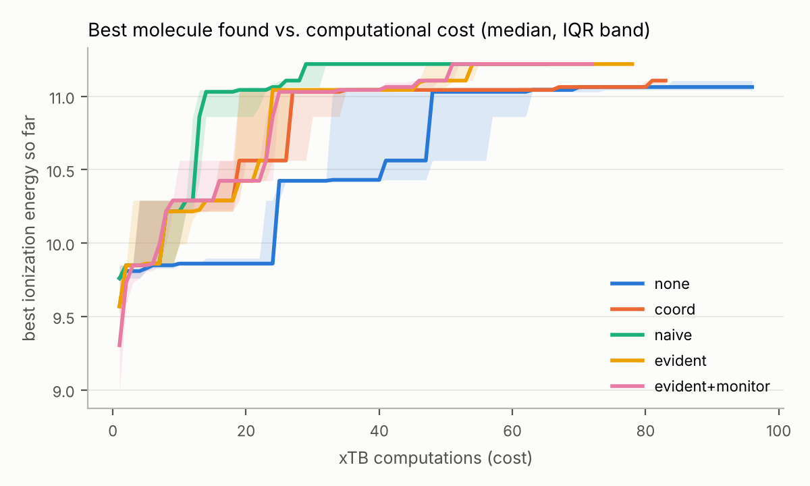
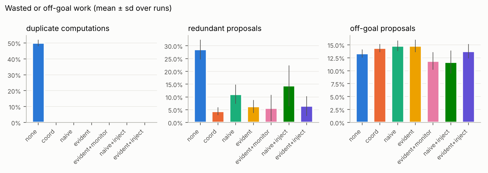
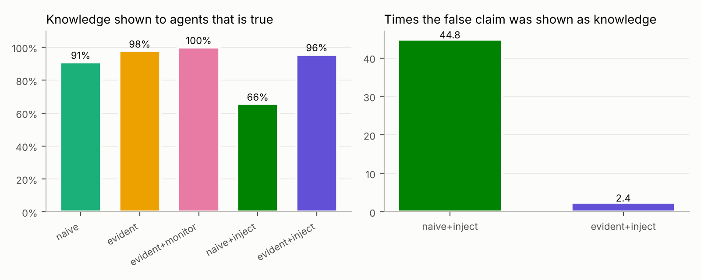

# EVIDENT experiment report: `synth5`

- runs: 35 (none: 5, coord: 5, naive: 5, evident: 5, evident+monitor: 5, naive+inject: 5, evident+inject: 5)
- common budget for `best_at_budget`: first 62 xTB computations of each run
- ground truth for claims: known rules of the synthetic xTB
- ground-truth directions: fluorine up, nitrile up, carbonyl up, amine down, aromatic_ring down, methyl down

## Metrics per condition (mean, 95% bootstrap CI)

| metric | none | coord | naive | evident | evident+monitor | naive+inject | evident+inject |
|---|---|---|---|---|---|---|---|
| best IE within the common budget of xTB runs (`best_at_budget`) | 10.9 [10.8, 11.1] | 11.1 [11, 11.1] | 11.2 [11.2, 11.2] | 11.2 [11.2, 11.2] | 11.2 [11.2, 11.2] | 11.2 [11.2, 11.2] | 11.2 [11.1, 11.2] |
| best IE of the campaign (`best_energy`) | 11.1 [11, 11.1] | 11.1 [11.1, 11.2] | 11.2 [11.2, 11.2] | 11.2 [11.2, 11.2] | 11.2 [11.2, 11.2] | 11.2 [11.2, 11.2] | 11.2 [11.2, 11.2] |
| mean of the 5 best (`top5_mean`) | 10.8 [10.6, 10.9] | 11 [11, 11.1] | 11.1 [11.1, 11.1] | 11.1 [11.1, 11.1] | 11.1 [11.1, 11.1] | 11.1 [11.1, 11.1] | 11.1 [11.1, 11.1] |
| xTB computations (`xtb_runs`) | 96 [96, 96] | 85.8 [83.4, 88.2] | 77 [70.8, 80.8] | 80.6 [78.2, 83] | 76.8 [73.4, 80.6] | 72.6 [65.4, 79.8] | 79.2 [75.4, 82.6] |
| duplicate computations / runs (`duplicate_rate`) | 0.5 [0.481, 0.517] | 0 [0, 0] | 0 [0, 0] | 0 [0, 0] | 0 [0, 0] | 0 [0, 0] | 0 [0, 0] |
| proposals of already known molecules (`redundant_proposal_rate`) | 0.285 [0.256, 0.319] | 0.0437 [0.0312, 0.0563] | 0.11 [0.0813, 0.144] | 0.0625 [0.0417, 0.0854] | 0.0563 [0.0104, 0.102] | 0.144 [0.0832, 0.223] | 0.0646 [0.0271, 0.0958] |
| computations of already failed molecules (`invalid_repeat`) | 0 [0, 0] | 0 [0, 0] | 0 [0, 0] | 0 [0, 0] | 0 [0, 0] | 0 [0, 0] | 0 [0, 0] |
| proposals breaking a Goal constraint (`violation_rate`) | 0.133 [0.127, 0.14] | 0.144 [0.137, 0.15] | 0.148 [0.14, 0.158] | 0.148 [0.138, 0.158] | 0.119 [0.104, 0.133] | 0.117 [0.0979, 0.135] | 0.138 [0.125, 0.148] |
| distinct valid molecules measured (`unique_valid`) | 48 [46.4, 49.8] | 80.4 [79.6, 81.4] | 76.6 [70.6, 80.6] | 79 [78, 81] | 71.8 [70.2, 73.2] | 72.6 [65.4, 79.8] | 76.6 [73.6, 79.6] |
| distinct Murcko scaffolds (`scaffolds`) | 3 [3, 3] | 3 [3, 3] | 3 [3, 3] | 3 [3, 3] | 3 [3, 3] | 3 [3, 3] | 3 [3, 3] |
| mean pairwise Tanimoto distance (`diversity`) | 0.815 [0.81, 0.819] | 0.843 [0.842, 0.845] | 0.848 [0.845, 0.851] | 0.851 [0.848, 0.854] | 0.852 [0.848, 0.857] | 0.85 [0.842, 0.856] | 0.847 [0.843, 0.852] |
| claims asserted by agents that are true (`assertion_accuracy`) | 0.916 [0.867, 0.966] | 0.9 [0.833, 0.967] | 0.933 [0.883, 0.983] | 0.908 [0.833, 0.983] | 0.909 [0.8, 1] | 0.9 [0.778, 0.989] | 0.944 [0.9, 0.989] |
| knowledge SHOWN to agents that is true (`exposure_precision`) | – | – | 0.91 [0.845, 0.975] | 0.979 [0.936, 1] | 1 [1, 1] | 0.657 [0.514, 0.762] | 0.957 [0.895, 1] |
| false knowledge items shown to agents (`false_exposures`) | 0 [0, 0] | 0 [0, 0] | 23.6 [6.6, 40.6] | 2.4 [0, 7.2] | 0 [0, 0] | 91.4 [63.6, 130] | 3.6 [0, 8.4] |
| share of proposals with the injected feature (after - before) (`injection_adoption_delta`) | – | – | – | – | – | -0.15 [-0.293, -0.0533] | -0.23 [-0.33, -0.143] |
| times the injected claim was shown as knowledge (`injected_exposures`) | – | – | – | – | – | 44.8 [23, 66.2] | 2.4 [0, 7.2] |
| STOP directives applied (`stops`) | 0 [0, 0] | 0 [0, 0] | 0 [0, 0] | 0 [0, 0] | 8.2 [5.2, 11.2] | 0 [0, 0] | 0 [0, 0] |
| computations cancelled by a directive (`cancelled`) | 0 [0, 0] | 0 [0, 0] | 0 [0, 0] | 0 [0, 0] | 11.2 [7.2, 15.2] | 0 [0, 0] | 0 [0, 0] |
| STOP sent -> activity cancelled (s) (`stop_reaction_s`) | – | – | – | – | 0.51 [0.508, 0.511] | – | – |
| event -> STOP sent (s) (`detection_s`) | – | – | – | – | 0.00109 [0.000465, 0.00187] | – | – |
| violation rate after the first STOP (`violation_rate_after_stop`) | – | – | – | – | 0 [0, 0] | – | – |
| briefing build time (ms) (`briefing_ms`) | 0.33 [0.294, 0.362] | 1.12 [1.04, 1.2] | 1.3 [1.22, 1.37] | 1.45 [1.18, 1.88] | 1.48 [1.33, 1.62] | 1.22 [1.08, 1.35] | 1.26 [1.15, 1.35] |
| briefing size (characters) (`briefing_chars`) | 212 [212, 212] | 629 [625, 633] | 1.05e+03 [1.03e+03, 1.06e+03] | 1.06e+03 [927, 1.19e+03] | 1.19e+03 [1.1e+03, 1.28e+03] | 1.1e+03 [1.07e+03, 1.12e+03] | 1.22e+03 [1.06e+03, 1.38e+03] |
| memory time / wall time (`memory_overhead`) | 0.00167 [0.00149, 0.00184] | 0.00562 [0.00508, 0.00608] | 0.00612 [0.00575, 0.00649] | 0.011 [0.0096, 0.0124] | 0.0125 [0.011, 0.0137] | 0.00597 [0.00539, 0.00646] | 0.0106 [0.00977, 0.0113] |
| campaign wall time (s) (`wall_time_s`) | 13.4 [13.4, 13.5] | 13.6 [13.4, 14] | 14.4 [14.4, 14.4] | 14.5 [13.9, 15.1] | 13.2 [12.5, 13.9] | 13.8 [13.4, 14.3] | 14.4 [13.8, 15] |

## Research questions (Mann-Whitney U, Cliff's delta: B vs A)

| question | metric | A | B | mean A | mean B | p | delta | better? |
|---|---|---|---|---|---|---|---|---|
| Q1 coordination | best_at_budget | none | coord | 10.9 | 11.1 | 0.234 | 0.48 | yes |
| Q1 coordination | best_energy | none | coord | 11.1 | 11.1 | 0.233 | 0.48 | yes |
| Q1 coordination | top5_mean | none | coord | 10.8 | 11 | 0.00794 | 1 | yes |
| Q1 coordination | xtb_runs | none | coord | 96 | 85.8 | 0.00709 | -1 | yes |
| Q1 coordination | duplicate_rate | none | coord | 0.5 | 0 | 0.00749 | -1 | yes |
| Q1 coordination | redundant_proposal_rate | none | coord | 0.285 | 0.0437 | 0.0109 | -1 | yes |
| Q1 coordination | violation_rate | none | coord | 0.133 | 0.144 | 0.125 | 0.6 | no |
| Q1 coordination | unique_valid | none | coord | 48 | 80.4 | 0.0119 | 1 | yes |
| Q1 coordination | diversity | none | coord | 0.815 | 0.843 | 0.00794 | 1 | yes |
| Q1 coordination | assertion_accuracy | none | coord | 0.916 | 0.9 | 0.743 | -0.16 | no |
| Q1 coordination | briefing_ms | none | coord | 0.33 | 1.12 | 0.00794 | 1 | no |
| Q1 coordination | memory_overhead | none | coord | 0.00167 | 0.00562 | 0.00794 | 1 | no |
| Q2 verified vs raw knowledge | xtb_runs | naive | evident | 77 | 80.6 | 0.831 | 0.12 | no |
| Q2 verified vs raw knowledge | redundant_proposal_rate | naive | evident | 0.11 | 0.0625 | 0.0749 | -0.72 | yes |
| Q2 verified vs raw knowledge | violation_rate | naive | evident | 0.148 | 0.148 | 1 | -0.04 | yes |
| Q2 verified vs raw knowledge | unique_valid | naive | evident | 76.6 | 79 | 0.823 | -0.12 | yes |
| Q2 verified vs raw knowledge | diversity | naive | evident | 0.848 | 0.851 | 0.421 | 0.36 | yes |
| Q2 verified vs raw knowledge | assertion_accuracy | naive | evident | 0.933 | 0.908 | 0.745 | -0.16 | no |
| Q2 verified vs raw knowledge | exposure_precision | naive | evident | 0.91 | 0.979 | 0.158 | 0.52 | yes |
| Q2 verified vs raw knowledge | false_exposures | naive | evident | 23.6 | 2.4 | 0.158 | -0.52 | yes |
| Q2 verified vs raw knowledge | briefing_ms | naive | evident | 1.3 | 1.45 | 0.841 | -0.12 | no |
| Q2 verified vs raw knowledge | memory_overhead | naive | evident | 0.00612 | 0.011 | 0.00794 | 1 | no |
| Q3 robustness to a false claim | best_at_budget | naive+inject | evident+inject | 11.2 | 11.2 | 0.177 | -0.4 | no |
| Q3 robustness to a false claim | xtb_runs | naive+inject | evident+inject | 72.6 | 79.2 | 0.346 | 0.4 | no |
| Q3 robustness to a false claim | redundant_proposal_rate | naive+inject | evident+inject | 0.144 | 0.0646 | 0.0927 | -0.68 | yes |
| Q3 robustness to a false claim | violation_rate | naive+inject | evident+inject | 0.117 | 0.138 | 0.202 | 0.52 | no |
| Q3 robustness to a false claim | unique_valid | naive+inject | evident+inject | 72.6 | 76.6 | 0.69 | 0.2 | yes |
| Q3 robustness to a false claim | diversity | naive+inject | evident+inject | 0.85 | 0.847 | 0.69 | -0.2 | no |
| Q3 robustness to a false claim | assertion_accuracy | naive+inject | evident+inject | 0.9 | 0.944 | 0.913 | 0.08 | yes |
| Q3 robustness to a false claim | exposure_precision | naive+inject | evident+inject | 0.657 | 0.957 | 0.0112 | 1 | yes |
| Q3 robustness to a false claim | false_exposures | naive+inject | evident+inject | 91.4 | 3.6 | 0.0112 | -1 | yes |
| Q3 robustness to a false claim | injection_adoption_delta | naive+inject | evident+inject | -0.15 | -0.23 | 0.295 | -0.44 | yes |
| Q3 robustness to a false claim | injected_exposures | naive+inject | evident+inject | 44.8 | 2.4 | 0.0178 | -0.92 | yes |
| Q3 robustness to a false claim | briefing_ms | naive+inject | evident+inject | 1.22 | 1.26 | 0.841 | 0.12 | no |
| Q3 robustness to a false claim | memory_overhead | naive+inject | evident+inject | 0.00597 | 0.0106 | 0.00794 | 1 | no |
| Q4 real-time control | xtb_runs | evident | evident+monitor | 80.6 | 76.8 | 0.207 | -0.52 | yes |
| Q4 real-time control | redundant_proposal_rate | evident | evident+monitor | 0.0625 | 0.0563 | 1 | -0.04 | yes |
| Q4 real-time control | violation_rate | evident | evident+monitor | 0.148 | 0.119 | 0.0452 | -0.8 | yes |
| Q4 real-time control | unique_valid | evident | evident+monitor | 79 | 71.8 | 0.0097 | -1 | no |
| Q4 real-time control | diversity | evident | evident+monitor | 0.851 | 0.852 | 1 | -0.04 | yes |
| Q4 real-time control | assertion_accuracy | evident | evident+monitor | 0.908 | 0.909 | 1 | 0.04 | yes |
| Q4 real-time control | exposure_precision | evident | evident+monitor | 0.979 | 1 | 0.424 | 0.2 | yes |
| Q4 real-time control | false_exposures | evident | evident+monitor | 2.4 | 0 | 0.424 | -0.2 | yes |
| Q4 real-time control | briefing_ms | evident | evident+monitor | 1.45 | 1.48 | 0.31 | 0.44 | no |
| Q4 real-time control | memory_overhead | evident | evident+monitor | 0.011 | 0.0125 | 0.222 | 0.52 | no |

With few repetitions per condition, p-values are indicative only; report effect sizes and confidence intervals, and increase the repetitions for the paper.

## Figures

